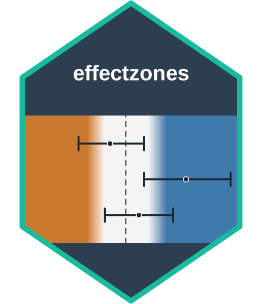
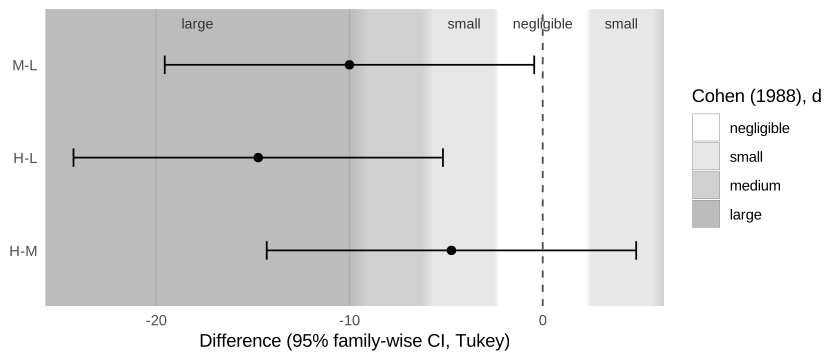
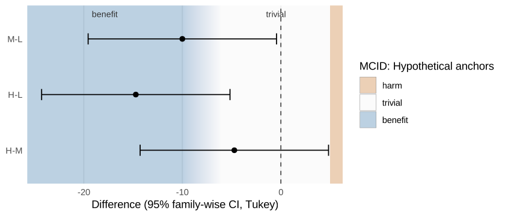
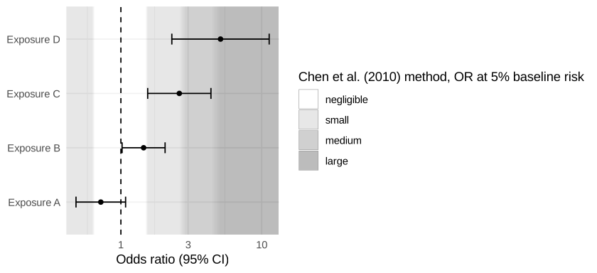

<!-- README.md is generated from README.Rmd. Please edit that file -->

# effectzones 

<!-- badges: start -->

[](https://lifecycle.r-lib.org/articles/stages.html#experimental)
[](https://github.com/drhrf/effectzones/actions/workflows/check-standard.yaml)
[](https://github.com/drhrf/effectzones/actions/workflows/pkgdown.yaml)
<!-- badges: end -->

effectzones is a ggplot2 extension that draws **interpretive background
zones** behind estimates and confidence intervals, in forest plots,
post-hoc contrast plots and coefficient plots.

- `geom_es_zones()`: effect-size magnitude zones (negligible / small /
  medium / large …), symmetric around the null.
- `geom_mcid_zones()`: clinical relevance zones (harm / trivial /
  benefit) defined by a minimal clinically important difference, which
  can be asymmetric and uncertain.

The package does **not** compute, classify or reinterpret inference. It
never looks at your estimates; it only draws a background against which
the intervals you already have are read. There is no default benchmark
set and no automatic MCID: you choose the thresholds, and the legend
records where they come from.

## Installation

``` r
# install.packages("pak")
pak::pak("drhrf/effectzones")
```

## Tukey contrasts over effect-size zones

Standardised thresholds (here Cohen’s d, used only as an illustration;
see the vignette on choosing a set) are converted to the raw scale of
the contrasts. For a one-way model `plot_contrasts()` uses the model’s
pooled within-group SD and says so; for anything more complex it asks
you to choose the SD.

``` r
library(effectzones)
library(ggplot2)

fit <- aov(breaks ~ tension, data = warpbreaks)
plot_contrasts(
  fit,
  zones = geom_es_zones(es_benchmarks("cohen_d"), labels = TRUE)
)
#> ℹ Converting d thresholds with the residual (pooled within-group) SD of the
#>   one-way model: 11.9.
#>   Set `sd` in the zones layer to use a different SD.
```



## The same contrasts over MCID zones

An asymmetric MCID: deterioration at 5 breaks, improvement somewhere
between 6 and 10 breaks (say, two anchor studies that disagree). Fewer
breaks are better. The uncertain threshold is drawn as a fade across its
range.

``` r
mcid <- mcid_thresholds(
  lower = c(-10, -6), upper = 5,
  direction = "lower_better",
  source = "Hypothetical anchors"
)
plot_contrasts(fit, zones = geom_mcid_zones(mcid, labels = TRUE))
```



## An odds-ratio forest plot on a log axis

The Chen, Cohen & Chen (2010) odds ratios correspond to d = 0.2 / 0.5 /
0.8 at a 1% baseline risk; `chen_or_thresholds()` computes them for any
baseline risk. Under their method the zones below 1 are not mirror
images of those above 1, and are drawn accordingly.

``` r
or <- data.frame(
  term = c("Exposure A", "Exposure B", "Exposure C", "Exposure D"),
  estimate = c(0.72, 1.45, 2.60, 5.10),
  lower = c(0.48, 1.02, 1.55, 2.30),
  upper = c(1.08, 2.06, 4.36, 11.3)
)
ggplot(or, aes(estimate, term)) +
  geom_es_zones(chen_or_thresholds(0.05), scale = "log", null = 1) +
  geom_vline(xintercept = 1, linetype = 2) +
  geom_errorbar(aes(xmin = lower, xmax = upper), width = 0.2) +
  geom_point() +
  scale_x_log10() +
  labs(x = "Odds ratio (95% CI)", y = NULL) +
  theme_minimal()
```



Add the zones layer **before** points and error bars so they are drawn
on top. Zones do not change the axis limits unless you set
`expand = TRUE`, and the legend lists only the zones that appear in the
plot. Rename zones with `zone_labels`,
e.g. `zone_labels = c(negligible = "below small")`.

## What effectzones deliberately does not do

It does not label results as “meaningful” or “likely beneficial”, and it
does not compute the probability that an effect lies in a zone. That is
magnitude-based inference, which has been shown to be statistically
unsound (Welsh & Knight 2015; Sainani 2018). See
`vignette("effectzones")` and [DESIGN.md](DESIGN.md).

## Documentation

The [package website](https://drhrf.github.io/effectzones/) has the
reference, the guide *Reading estimates against zones*, and [*The
mathematics behind
effectzones*](https://drhrf.github.io/effectzones/articles/articles/mathematics.html),
which works through every calculation step by step with interactive
examples.
