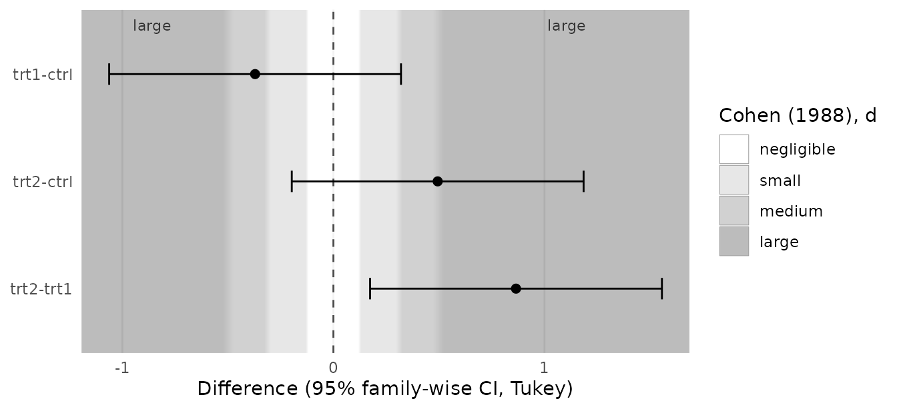
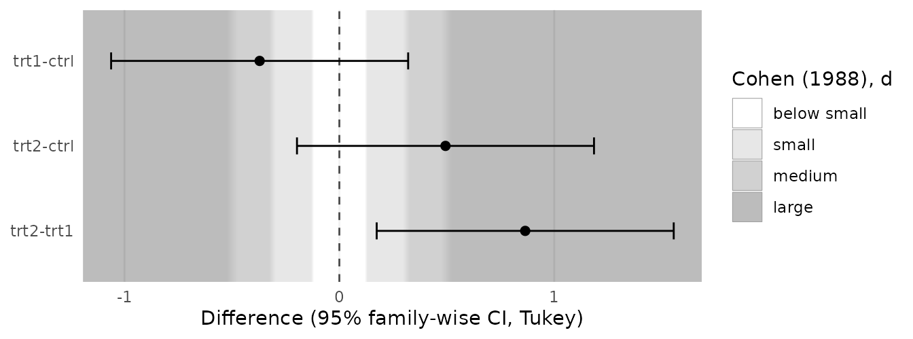
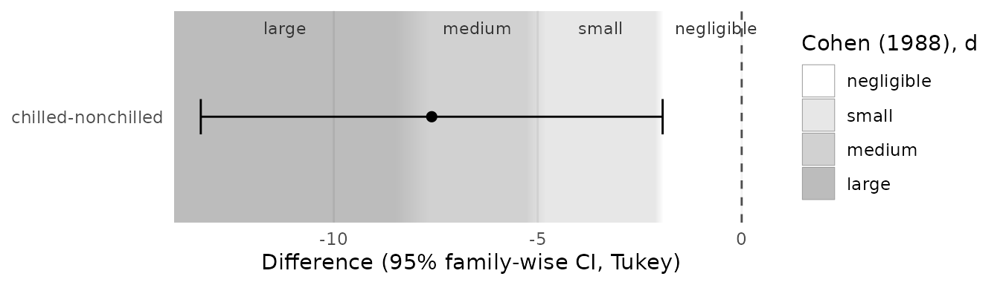
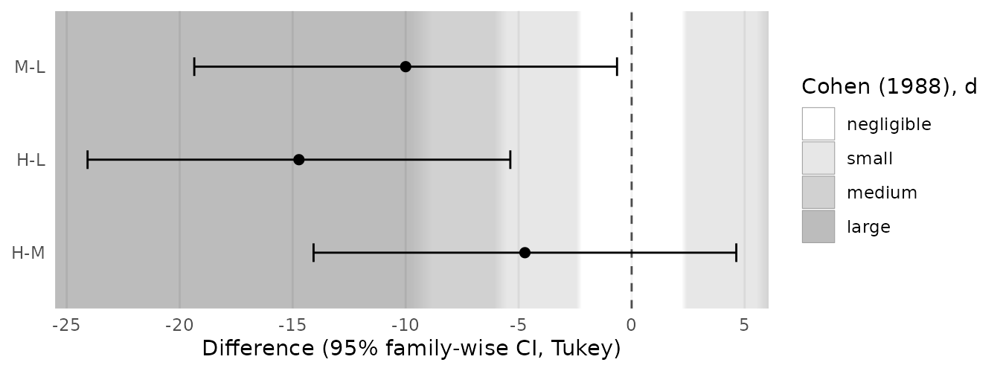
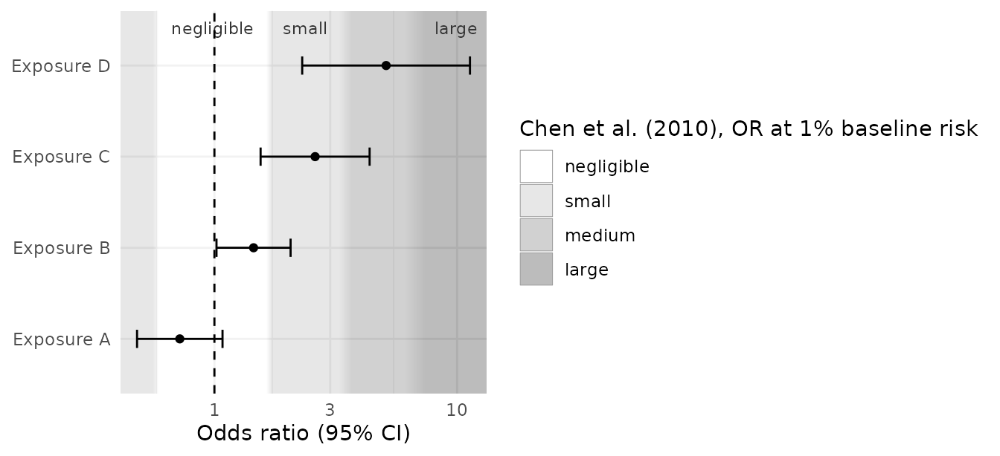
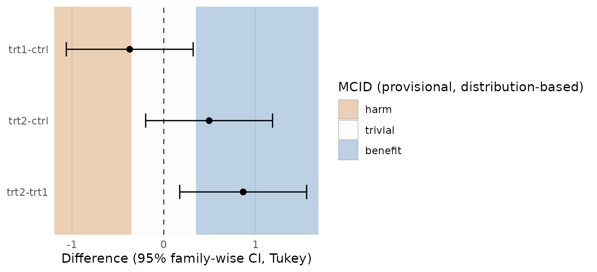
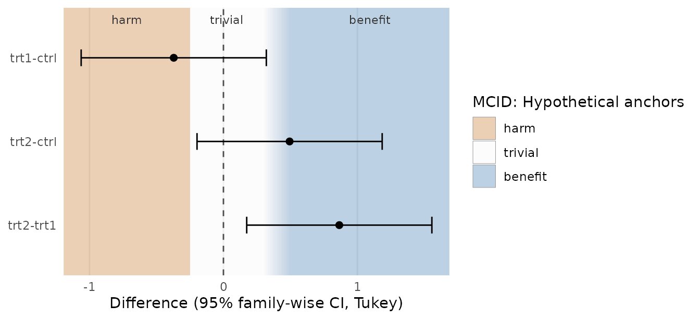
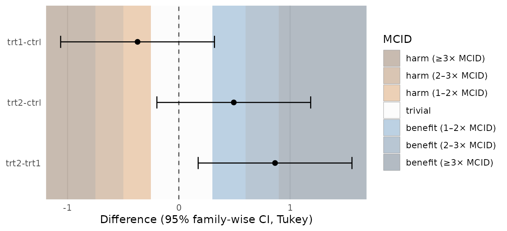
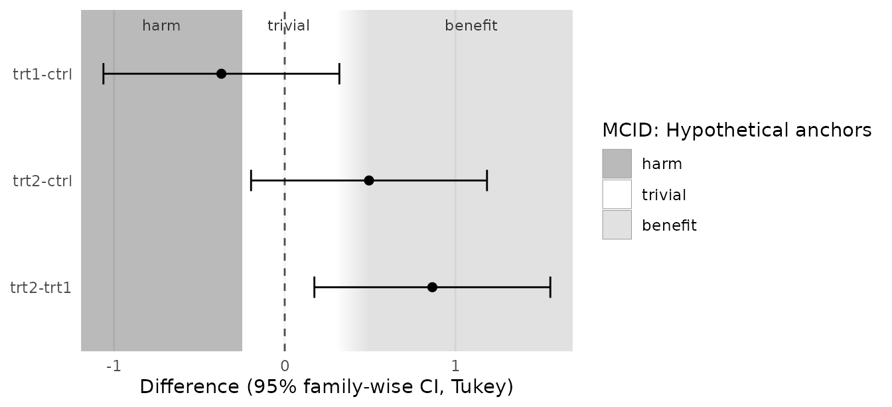

# Reading estimates against zones

``` r

library(effectzones)
library(ggplot2)
```

effectzones draws a background behind estimates and confidence
intervals. The background marks regions of the effect axis that someone
has judged “small”, “large”, “clinically trivial” or “beneficial”. The
package never looks at your estimates: it does not test them, classify
them or compute any probability. You read the interval against the
background, and you decide what it means.

## Why backgrounds instead of verdicts

A confidence interval already contains the inferential information: the
range of effects compatible with the data under the model. What readers
often lack is a reference frame for magnitude. Is a difference of 0.5 kg
large? Is an odds ratio of 1.4 worth acting on? Benchmarks answer that
question, imperfectly, and putting them behind the interval shows the
interval and the benchmark together without merging them into a verdict.

A verdict (“likely beneficial”, “trivial”) hides two things: where the
interval lies relative to the threshold, and how arbitrary the threshold
is. A background shows both. An interval that straddles a boundary is
visibly ambiguous; a soft, fading boundary is visibly a convention, not
a natural discontinuity.

The basic plot, a Tukey post-hoc comparison over effect-size zones:

``` r

fit <- aov(weight ~ group, data = PlantGrowth)
plot_contrasts(
  fit,
  zones = geom_es_zones(es_benchmarks("cohen_d"), labels = TRUE)
)
#> ℹ Converting d thresholds with the residual (pooled within-group) SD of the
#>   one-way model: 0.623.
#>   Set `sd` in the zones layer to use a different SD.
```



Two layers do the work, and you can use them in any ggplot:

- [`geom_es_zones()`](https://drhrf.github.io/effectzones/reference/geom_es_zones.md):
  effect-size magnitude zones around the null.
- [`geom_mcid_zones()`](https://drhrf.github.io/effectzones/reference/geom_mcid_zones.md):
  harm / trivial / benefit zones from a minimal clinically important
  difference (MCID).

Add the zones layer **first**, so that points, error bars and reference
lines are drawn on top of it. By default the zones do not change the
axis limits: they fill whatever range your data define, and the
outermost zones extend to the panel edges. The legend lists only the
zones that appear in the plot. Use `expand = TRUE` if every cut-point
should be visible.

## Choosing a benchmark set, and why there is no default

[`geom_es_zones()`](https://drhrf.github.io/effectzones/reference/geom_es_zones.md)
has no default thresholds. Calling it without them is an error that
lists the published sets:

``` r

geom_es_zones()
#> Error in `geom_es_zones()`:
#> ! `thresholds` is required: there is no default benchmark set.
#> ℹ Cohen (1988) offered his d = 0.2/0.5/0.8 only as a fallback; choose
#>   thresholds that suit your field.
#> ℹ Published sets: "cohen_d", "sawilowsky_d", "cohen_r", "funder_ozer_r",
#>   "gignac_szodorai_r", "cohen_eta2", "cohen_f", or "chen_or", e.g. `thresholds
#>   = es_benchmarks("cohen_d")`.
#> ℹ Or define your own with `es_thresholds()`.
```

This is deliberate. Cohen (1988) proposed d = 0.2, 0.5 and 0.8 as
conventions to fall back on when nothing better is known about the area
of research, and warned against using them mechanically. Later sets were
derived from what is typical in particular literatures: Gignac &
Szodorai (2016) from meta-analytic correlations in
individual-differences research, Funder & Ozer (2019) from a broader
argument about psychological effects. A “medium” effect in one field is
large in another. Choosing the set is a substantive decision, and the
plot should record it: the legend title names the source.

``` r

es_benchmarks()
#> "cohen_d": d, cuts 0.2, 0.5, and 0.8 (Cohen (1988), d)
#> "sawilowsky_d": d, cuts 0.01, 0.2, 0.5, 0.8, 1.2, and 2 (Sawilowsky (2009), d)
#> "cohen_r": r, cuts 0.1, 0.3, and 0.5 (Cohen (1988), r)
#> "funder_ozer_r": r, cuts 0.05, 0.1, 0.2, 0.3, and 0.4 (Funder & Ozer (2019), r)
#> "gignac_szodorai_r": r, cuts 0.1, 0.2, and 0.3 (Gignac & Szodorai (2016), r)
#> "cohen_eta2": eta2, cuts 0.01, 0.06, and 0.14 (Cohen (1988), η²)
#> "cohen_f": f, cuts 0.1, 0.25, and 0.4 (Cohen (1988), f)
#> "chen_or": or, cuts 1.68, 3.47, and 6.71 (Chen et al. (2010), OR at 1% baseline
#> risk)
```

If your field has its own thresholds, use them:

``` r

my_cuts <- es_thresholds(
  cuts = c(0.1, 0.3),
  labels = c("trivial", "modest", "substantial"),
  metric = "d",
  source = "Protocol v2, section 9"
)
my_cuts
#> <es_thresholds> on the "d" scale
#> trivial: magnitude in [0, 0.1)
#> modest: magnitude in [0.1, 0.3)
#> substantial: magnitude in [0.3, Inf)
#> Source: Protocol v2, section 9
```

The cited sources define cut-points. The label of the innermost zone
(“negligible”) is a convention of this package, not of the sources.
Rename any zone with `zone_labels`, either all at once or by name:

``` r

plot_contrasts(
  fit,
  zones = geom_es_zones(es_benchmarks("cohen_d"),
                        zone_labels = c(negligible = "below small"))
)
#> ℹ Converting d thresholds with the residual (pooled within-group) SD of the
#>   one-way model: 0.623.
#>   Set `sd` in the zones layer to use a different SD.
```



## Converting thresholds to the plot scale, and which SD to use

Benchmarks are usually standardised; estimates are often not. Contrasts
from an ANOVA are differences in the outcome’s own units, so
standardised thresholds have to be converted: a cut d is drawn at d ×
SD.

``` r

to_plot_scale(es_benchmarks("cohen_d"), sd = 2)
#> <es_thresholds> on the "raw" scale
#> negligible: magnitude in [0, 0.4)
#> small: magnitude in [0.4, 1)
#> medium: magnitude in [1, 1.6)
#> large: magnitude in [1.6, Inf)
#> Source: Cohen J (1988). Statistical Power Analysis for the Behavioral Sciences,
#> 2nd ed. Hillsdale, NJ: Lawrence Erlbaum. doi:10.4324/9780203771587. Cohen
#> offered these values as conventions for use only when no better basis for
#> judging magnitude is available.
#> Note: d cut-points multiplied by SD = 2.
```

Which SD to use is not a technicality: the same benchmark drawn with a
different SD lands in a different place, and changes how the intervals
read.

**One-way models.** In `aov(y ~ group)` the residual SD (the square root
of the ANOVA’s mean squared error) is the pooled within-group SD. That
is the usual denominator of Cohen’s d, and it is the same quantity the
ANOVA F test and the Tukey intervals already rely on, under the same
equal-variance assumption.
[`plot_contrasts()`](https://drhrf.github.io/effectzones/reference/plot_contrasts.md)
therefore takes it from the model automatically and prints its value. It
works from the `aov` fit, from an `emmeans()` grid of means, and from a
`TukeyHSD` object: [`TukeyHSD()`](https://rdrr.io/r/stats/TukeyHSD.html)
keeps the call that fitted the model but not the model itself, so the
call is re-run and the result is used only if it reproduces the Tukey
contrasts exactly.

``` r

tk <- TukeyHSD(fit)
plot_contrasts(tk, zones = geom_es_zones(es_benchmarks("cohen_d")))
#> ℹ Refitted `aov(formula = weight ~ group, data = PlantGrowth)` to get the
#>   model's SD; it reproduces these Tukey contrasts exactly.
#> ℹ Converting d thresholds with the residual (pooled within-group) SD of the
#>   one-way model: 0.623.
#>   Set `sd` in the zones layer to use a different SD.
```


**Everything else.** With several factors, covariates or interactions,
the residual SD has the variance of every other term removed. Whether
that is right depends on what those terms are, and the model object
cannot tell:

- **Manipulated (randomised) factors** — a second treatment, a dose, a
  task condition — create variation that does not exist in the
  population. Removing it from the SD is correct.
- **Measured factors and covariates** — sex, age, site, baseline score —
  are ordinary differences between people. Removing them shrinks the SD,
  inflates d and narrows the zones.

So
[`plot_contrasts()`](https://drhrf.github.io/effectzones/reference/plot_contrasts.md)
does not choose. It stops and explains the rigorous procedure, in order
of preference:

1.  **Decide what the benchmark’s SD refers to**, and fix it before
    seeing the results. Usually that is the SD of the outcome in the
    target population, at baseline.
2.  **Best option: an external, pre-specified SD**, for example the
    baseline SD from the protocol or from a large prior study. It
    doesn’t depend on the model, isn’t inflated by covariate adjustment,
    and can’t be tuned after looking at the contrasts. This is what
    `sd =` allows.
3.  **If the SD must come from the data**: refit the model with only the
    manipulated factors (the factor of interest, other randomised
    factors, and their interactions), and use that model’s residual SD.
    Measured factors and covariates go back into the error term. That
    gives the SD of people within treatment cells, the generalized
    standardizer behind Olejnik & Algina (2003). For a randomised ANCOVA
    this amounts to using the unadjusted within-group SD instead of the
    covariate-adjusted one.
4.  **State the remaining sampling uncertainty.** The SD is still an
    estimate with finite degrees of freedom, so it has its own
    confidence interval, and that uncertainty carries into where each
    boundary sits (d × SD). effectzones does not draw it yet; report the
    SD, its source and its confidence interval with the plot.

This can’t be fully automatic: whether a factor is manipulated or
measured depends on the study design, and the model doesn’t record it.

An example where it matters. In the `CO2` data, plants were chilled or
not (manipulated) and came from Quebec or Mississippi (measured: an
origin, not a treatment). At the highest CO₂ concentration:

``` r

co2 <- subset(CO2, conc == 1000)
fit_co2 <- aov(uptake ~ Treatment + Type, data = co2)
plot_contrasts(fit_co2, which = "Treatment",
               zones = geom_es_zones(es_benchmarks("cohen_d")))
#> Error in `plot_contrasts()`:
#> ! Not choosing an SD for you: the model has 2 terms (Treatment, Type),
#>   not one.
#> ℹ The model's residual SD has the variance of every other term removed. That is
#>   right for factors you manipulated (randomised), but too small for factors you
#>   only measured (sex, age, site, baseline covariates): it inflates d and
#>   narrows the zones.
#>   
#>   The rigorous procedure, in order of preference:
#>   1. Decide what the benchmark's SD refers to, and fix it before seeing the
#>   results. Usually that is the SD of the outcome in the target population, at
#>   baseline.
#>   2. Best option: an external, pre-specified SD, for example the baseline SD
#>   from the protocol or from a large prior study. It doesn't depend on the
#>   model, isn't inflated by covariate adjustment, and can't be tuned after
#>   looking at the contrasts. Give it as `geom_es_zones(..., sd = <value>)`.
#>   3. If the SD must come from the data: refit the model with only the
#>   manipulated factors (the factor of interest, other randomised factors, and
#>   their interactions), and use that model's residual SD. Measured factors and
#>   covariates go back into the error term. That gives the SD of people within
#>   treatment cells, the generalized standardizer behind Olejnik & Algina (2003).
#>   For a randomised ANCOVA this amounts to the unadjusted within-group SD
#>   instead of the covariate-adjusted one. For example, if only Treatment was
#>   randomised: `sd = pooled_sd(update(model, . ~ Treatment))`, where `model` is
#>   your fitted model. If every term in the model was manipulated (a fully
#>   randomised factorial), the model's own residual SD is the answer: `sd =
#>   pooled_sd(model)`.
#>   4. State the remaining sampling uncertainty. The SD is still an estimate with
#>   finite degrees of freedom, so it has its own confidence interval, and that
#>   uncertainty carries into where each boundary sits (d × SD). effectzones does
#>   not draw it yet: report the SD, where it came from, and its confidence
#>   interval with the plot.
#>   
#> ! This can't be fully automatic. Whether a factor is manipulated or measured
#>   depends on the study design, and the model object doesn't record it. So
#>   effectzones can't infer it; you have to say.
#> ℹ Worked examples: `vignette("effectzones")`, section "Converting thresholds to
#>   the plot scale, and which SD to use".
```

The residual SD of the full model removes the large difference between
origins; refitting with the manipulated factor only puts it back:

``` r

pooled_sd(fit_co2)                             # origin removed: too small
#> [1] 4.334786
pooled_sd(update(fit_co2, . ~ Treatment))      # step 3: the standardizer
#> [1] 10.09553
```

Using the first would make every zone 2.3 times narrower than the
benchmark intends. With step 3:

``` r

plot_contrasts(fit_co2, which = "Treatment",
               zones = geom_es_zones(es_benchmarks("cohen_d"),
                                     sd = pooled_sd(update(fit_co2, . ~ Treatment)),
                                     labels = TRUE))
```



When every term was manipulated, as in `warpbreaks` (wool type and
tension were both set by the experimenter), step 3 keeps them all and
the model’s own residual SD is the standardizer:

``` r

fit2 <- aov(breaks ~ wool + tension, data = warpbreaks)
plot_contrasts(fit2, which = "tension",
               zones = geom_es_zones(es_benchmarks("cohen_d"),
                                     sd = pooled_sd(fit2)))
```



In models with several variance components (repeated measures, random
effects) there is no single residual SD; supply the one your benchmark
refers to. The calculations behind each step are worked through in the
article *The mathematics behind effectzones* on the package website.

For **ratios** (odds ratios, risk ratios), a cut c is drawn at c and
1/c, symmetric on the log scale, unless the thresholds say otherwise
(below). Use `scale = "log"`, `null = 1`, and a log axis:

``` r

or <- data.frame(
  term = c("Exposure A", "Exposure B", "Exposure C", "Exposure D"),
  estimate = c(0.72, 1.45, 2.60, 5.10),
  lower = c(0.48, 1.02, 1.55, 2.30),
  upper = c(1.08, 2.06, 4.36, 11.3)
)
ggplot(or, aes(estimate, term)) +
  geom_es_zones(es_benchmarks("chen_or"), scale = "log", null = 1,
                labels = TRUE) +
  geom_vline(xintercept = 1, linetype = 2) +
  geom_errorbar(aes(xmin = lower, xmax = upper), width = 0.2) +
  geom_point() +
  scale_x_log10() +
  labs(x = "Odds ratio (95% CI)", y = NULL) +
  theme_minimal()
```



Chen, Cohen & Chen (2010) derived these odds ratios as the equivalents
of d = 0.2, 0.5 and 0.8 **when the event rate in the reference group is
1%**. Their method places both groups on a latent normal scale: with
reference risk p0, a shift d gives an exposed risk p1 = Φ(Φ⁻¹(p0) + d),
and the odds ratio follows from p0 and p1.
[`chen_or_thresholds()`](https://drhrf.github.io/effectzones/reference/chen_or_thresholds.md)
implements it for any baseline risk; it reproduces the published 1%
values (1.68, 3.47, 6.71) and 5% values (1.52, 2.74, 4.72):

``` r

chen_or_thresholds(0.10)
#> <es_thresholds> on the "or" scale
#> negligible (above null): magnitude in [1, 1.46)
#> small (above null): magnitude in [1.46, 2.5)
#> medium (above null): magnitude in [2.5, 4.14)
#> large (above null): magnitude in [4.14, Inf)
#> negligible (below null): magnitude in [1, 1.49)
#> small (below null): magnitude in [1.49, 2.86)
#> medium (below null): magnitude in [2.86, 5.83)
#> large (below null): magnitude in [5.83, Inf)
#> Source: Odds ratios equivalent to d = 0.2/0.5/0.8 at a 10% baseline risk, by
#> the method of Chen H, Cohen P, Chen S (2010). Commun Stat Simul Comput
#> 39(4):860-864, doi:10.1080/03610911003650383. Boundaries below 1 apply the
#> method to negative d.
```

The same model shows that the zones are **not symmetric**. A protective
shift of −d does not give 1/OR: at a 1% baseline, d = −0.8 corresponds
to OR = 1/11.4, not 1/6.71. The two sides agree only at a 50% baseline.
So both `es_benchmarks("chen_or")` and
[`chen_or_thresholds()`](https://drhrf.github.io/effectzones/reference/chen_or_thresholds.md)
draw the boundaries below 1 from negative d. Chen et al. published only
the values above 1; the ones below 1 apply their method and are labelled
as such. Make sure the baseline risk is the risk in the reference group
of *your* odds ratios (the denominator group).

Alternatively, standardised thresholds can be converted to odds ratios
with the approximation log(OR) = d × π / √3 (Chinn 2000), which assumes
a logistic latent variable. Note that it gives different cut-points from
Chen et al.:

``` r

to_plot_scale(es_benchmarks("cohen_d"), scale = "log")$cuts
#> [1] 1.437291 2.476632 4.267548
```

Correlations, η² and Cohen’s f are drawn on their own scale only; there
is no conversion from them to raw differences.

## Anchor-based and distribution-based MCIDs

The MCID was introduced as “the smallest difference in score in the
domain of interest which patients perceive as beneficial” (Jaeschke,
Singer & Guyatt 1989). It is a statement about patients, so the
preferred way to estimate it is **anchor-based**: relate score changes
to an external judgement such as a global rating of change.

**Distribution-based** values (half an SD, one standard error of
measurement) describe the spread or the measurement error of the score,
not what patients value. McGlothlin & Lewis (2014) point out that such
values are not patient-derived. effectzones never computes an MCID for
you; if you want a distribution-based value you have to ask for one, and
the legend marks it provisional:

``` r

prov <- mcid_distribution(sd = 0.7, method = "half_sd")
prov
#> <mcid_thresholds> (higher_better)
#> harm: difference < -0.35
#> trivial: between -0.35 and 0.35
#> benefit: difference > 0.35
#> Provisional: not derived from patients' judgements.
#> Source: Half SD = 0.5 x 0.7 = 0.35. Norman GR, Sloan JA, Wyrwich KW (2003). Med
#> Care 41(5):582-592. doi:10.1097/01.mlr.0000062554.74615.4c. Equal to Cohen's
#> 'medium' d = 0.5. Distribution-based values are not patient-derived (McGlothlin
#> AE, Lewis RJ (2014). JAMA 312(13):1342-1343, doi:10.1001/jama.2014.13128) and
#> are provisional until an anchor-based MCID is available.
plot_contrasts(TukeyHSD(fit), zones = geom_mcid_zones(prov))
```



Norman, Sloan & Wyrwich (2003) observed that many anchor-based MCIDs for
health-related quality of life are close to half an SD. But half an SD
is exactly Cohen’s “medium” d = 0.5. A distribution-based MCID therefore
adds no clinical information beyond effect-size mode: it relabels the d
= 0.5 boundary in clinical language. If no anchor-based MCID exists,
saying so and using
[`geom_es_zones()`](https://drhrf.github.io/effectzones/reference/geom_es_zones.md)
is the more honest presentation.

## Within-patient MCIDs and between-group contrasts

Most MCIDs are defined for **change within a patient**: how much an
individual’s score must move for that individual to notice. Contrasts
from a trial or an ANOVA are **differences between group means**.
Reading a between-group difference against a within-patient MCID is
common, but contested: a mean difference smaller than the MCID can arise
when a fraction of patients improve by much more than the MCID and the
rest do not change, and a mean difference larger than the MCID does not
imply that every patient improved by that much. The background shows
where the estimate lies relative to the threshold; it cannot tell you
how individual responses are distributed.

When you present group differences over MCID zones, say which kind of
MCID was used and where it comes from (`source`), and consider reporting
responder proportions alongside.

## Asymmetric and uncertain MCIDs

Thresholds for deterioration and improvement need not be equal, and the
literature often gives more than one estimate of an MCID. Both are
supported: `lower` and `upper` are set separately, and either can be a
range.

``` r

thr <- mcid_thresholds(
  lower = -0.25,             # deterioration threshold
  upper = c(0.3, 0.5),       # improvement: two anchor studies disagree
  source = "Hypothetical anchors"
)
thr
#> <mcid_thresholds> (higher_better)
#> harm: difference < -0.25
#> trivial: between -0.25 and [0.3, 0.5]
#> benefit: difference > [0.3, 0.5]
#> Source: Hypothetical anchors
plot_contrasts(TukeyHSD(fit), zones = geom_mcid_zones(thr, labels = TRUE))
```



A range is drawn as a fade from one zone into the next across the whole
range, so the reader sees where the threshold is uncertain instead of a
sharp line placed at an arbitrary point within it. Point thresholds have
hard edges unless you set `softness`.

With `beyond = "multiples"` the colour keeps deepening at 2× and 3× the
MCID, so an estimate just past the threshold and one far beyond it do
not share a background:

``` r

plot_contrasts(TukeyHSD(fit),
               zones = geom_mcid_zones(mcid_thresholds(lower = -0.25, upper = 0.3),
                                       beyond = "multiples"))
```



Multiples need point thresholds. If the MCID itself is uncertain, so are
its multiples (an MCID of 4 to 6 puts “2×” anywhere from 8 to 12), and
sharp lines at 2× and 3× would claim a precision the MCID does not have,
so `beyond = "multiples"` with a range is an error.

If lower values of the outcome are better (pain, symptom scores), set
`direction = "lower_better"` and the benefit and harm sides swap.

For black-and-white output use `palette = "grey"`. Grey levels have no
natural direction, so add `labels = TRUE` or keep the legend:

``` r

plot_contrasts(TukeyHSD(fit),
               zones = geom_mcid_zones(thr, palette = "grey", labels = TRUE))
```



## Why the package does not classify results

It would be easy to add a function that reports, for each estimate, the
zone its point estimate falls in, or the probability that the true
effect is “beneficial”, “trivial” or “harmful”. effectzones deliberately
does not.

That procedure is known as magnitude-based inference (Batterham &
Hopkins 2006). Its classifications look like conclusions, but they
interpret a confidence interval as if it were a posterior distribution
under an implicit flat prior. Welsh & Knight (2015) showed that it is
neither a sound frequentist nor a coherent Bayesian procedure, and
Sainani (2018) showed that its type I error rates can be several times
those of standard hypothesis tests, depending on sample size and
thresholds. A plotting package that printed such labels would lend them
authority they do not have.

The zones are a reading aid. The inference is the interval; the
judgement is yours, and it should be argued in the text, with the
thresholds and their source stated.

## References

Batterham AM, Hopkins WG (2006). Making meaningful inferences about
magnitudes. *International Journal of Sports Physiology and Performance*
1(1):50-57. <doi:10.1123/ijspp.1.1.50>

Chen H, Cohen P, Chen S (2010). How big is a big odds ratio?
Interpreting the magnitudes of odds ratios in epidemiological studies.
*Communications in Statistics - Simulation and Computation*
39(4):860-864. <doi:10.1080/03610911003650383>

Chinn S (2000). A simple method for converting an odds ratio to effect
size for use in meta-analysis. *Statistics in Medicine*
19(22):3127-3131.
[doi:10.1002/1097-0258(20001130)19:22\<3127::AID-SIM784\>3.0.CO;2-M](https://doi.org/10.1002/1097-0258(20001130)19:22%3C3127::AID-SIM784%3E3.0.CO;2-M)

Cohen J (1988). *Statistical Power Analysis for the Behavioral
Sciences*, 2nd ed. Hillsdale, NJ: Lawrence Erlbaum.
<doi:10.4324/9780203771587>

Funder DC, Ozer DJ (2019). Evaluating effect size in psychological
research: sense and nonsense. *Advances in Methods and Practices in
Psychological Science* 2(2):156-168. <doi:10.1177/2515245919847202>

Gignac GE, Szodorai ET (2016). Effect size guidelines for individual
differences researchers. *Personality and Individual Differences*
102:74-78. <doi:10.1016/j.paid.2016.06.069>

Jaeschke R, Singer J, Guyatt GH (1989). Measurement of health status:
ascertaining the minimal clinically important difference. *Controlled
Clinical Trials* 10(4):407-415. <doi:10.1016/0197-2456(89)90005-6>

McGlothlin AE, Lewis RJ (2014). Minimal clinically important difference:
defining what really matters to patients. *JAMA* 312(13):1342-1343.
<doi:10.1001/jama.2014.13128>

Norman GR, Sloan JA, Wyrwich KW (2003). Interpretation of changes in
health-related quality of life: the remarkable universality of half a
standard deviation. *Medical Care* 41(5):582-592.
<doi:10.1097/01.mlr.0000062554.74615.4c>

Olejnik S, Algina J (2003). Generalized eta and omega squared
statistics: measures of effect size for some common research designs.
*Psychological Methods* 8(4):434-447. <doi:10.1037/1082-989X.8.4.434>

Sainani KL (2018). The problem with “magnitude-based inference”.
*Medicine & Science in Sports & Exercise* 50(10):2166-2176.
<doi:10.1249/mss.0000000000001645>

Sawilowsky SS (2009). New effect size rules of thumb. *Journal of Modern
Applied Statistical Methods* 8(2):597-599.
<doi:10.22237/jmasm/1257035100>

Welsh AH, Knight EJ (2015). “Magnitude-based inference”: a statistical
review. *Medicine & Science in Sports & Exercise* 47(4):874-884.
<doi:10.1249/mss.0000000000000451>

Wyrwich KW, Tierney WM, Wolinsky FD (1999). Further evidence supporting
an SEM-based criterion for identifying meaningful intra-individual
changes in health-related quality of life. *Journal of Clinical
Epidemiology* 52(9):861-873. <doi:10.1016/s0895-4356(99)00071-2>
